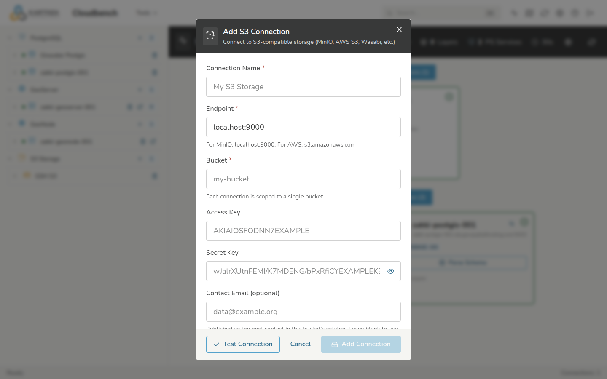

# Connections

Everything in CloudBench hangs off a **connection** — a saved pointer to one
service. This page covers adding, testing, and editing them. For what each
type is for, see [Overview & Workflow](overview.md).

Each connection is scoped to exactly one target — one GeoServer, one database
service, one GeoNode site, one S3 bucket — so you can add several of the same
type and switch between them in the tree.

## Adding a connection

1. In the left tree, find the connection type (**GeoServer**, **PostgreSQL**,
   **GeoNode**, or **S3 Storage**) and click the **+** beside it.
2. Fill in the form for that type (below).
3. Click **Test** — CloudBench checks it can reach the service and
   authenticate — then **Save**. A connection that fails the test is not saved.

Inside GeoHosting, the connections for your instances are usually added for
you; you can still add your own.

## What each type needs

| Type | Required | Notes |
| --- | --- | --- |
| **GeoServer** | Base URL, username, password | The REST URL, e.g. `https://…/geoserver`. |
| **PostgreSQL/PostGIS** | Host, port, database, user, password | The database must have PostGIS enabled to hold spatial tables. |
| **GeoNode** | Site URL, username, password | Uploads use the GeoNode account's permissions. |
| **S3 storage** | Endpoint, region, bucket, access key, secret key | One bucket per connection. Works with AWS S3, MinIO, and DigitalOcean Spaces. |

## Testing and editing

- **Test** re-runs the reachability and auth check at any time — use it when a
  service was down or a password changed.
- **Edit** (the pencil) changes a connection's details; CloudBench re-tests
  before saving.
- **Delete** (the trash icon) removes the connection from CloudBench. It does
  **not** touch the service or its data — only the saved pointer.

## When a connection fails

- **Cannot reach the service** — check the URL/host and port, and that the
  service is up and reachable from CloudBench's network (not only from your
  laptop).
- **Authentication failed** — re-enter the credentials; for GeoServer and
  GeoNode, confirm the account has the rights you need.
- **S3 errors** — check the endpoint and region match the provider, and that
  the keys can list the bucket. A wrong region is a common cause of signature
  errors.

More symptoms and fixes are in [Troubleshooting](troubleshooting.md).
