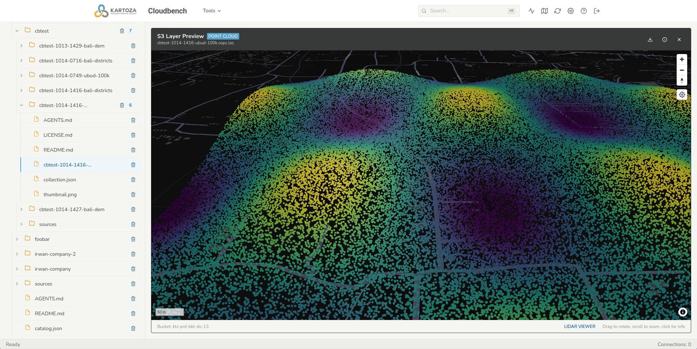

# Cloud-Native Formats

CloudBench can convert your uploads into **cloud-native** formats — files laid
out so a web map reads them straight from the bucket, a piece at a time, with
no server in front. This page explains each one and when to use it. To produce
them, see [On-demand Conversions](on-demand-conversions.md).

| Format | File | Holds | Use it for |
| --- | --- | --- | --- |
| **COG** | `.tif` | Raster (imagery, DEM) | Any raster you want to pan and zoom on the web |
| **PMTiles** | `.pmtiles` | Vector tiles | Rendering many features quickly at every zoom |
| **GeoParquet** | `.parquet` | Vector features + attributes | Querying and analysing the attribute table |
| **COPC** | `.copc.laz` | LiDAR point cloud | Streaming 3D points by area |

## COG — Cloud Optimized GeoTIFF

A GeoTIFF arranged into internal tiles and overviews so a viewer fetches only
the tiles in view at the right resolution. It is still a normal GeoTIFF that
any GIS can open. CloudBench produces a Web Mercator COG for the map preview.

## PMTiles

A single file of pre-rendered vector tiles. One HTTP file, read by range
requests, serves a whole tiled layer — no tile server. Best when a layer has
too many features to draw one by one.

## GeoParquet

A columnar table of features with their geometry and attributes. It is the
form to reach for when the question is about the data — filtering, counting,
joining — rather than drawing it. CloudBench writes a GeoParquet **alongside**
the PMTiles for a vector upload, so you get both the map and the table.

## COPC — Cloud Optimized Point Cloud

A LAZ point cloud organised as an octree so a viewer streams just the points
in view. Produced from `.las`/`.laz` uploads.

## How they relate to the preview

Each converted layer previews on the map or in a table without a backing
server (see [Layer Preview](preview.md)): COGs and PMTiles draw on the map,
GeoParquet opens as a table (and on the map), and COPC draws as a 3D point
cloud. The outputs are standard files, so you can also hand the bucket folder
to QGIS, GDAL, or any tool that reads these formats.
